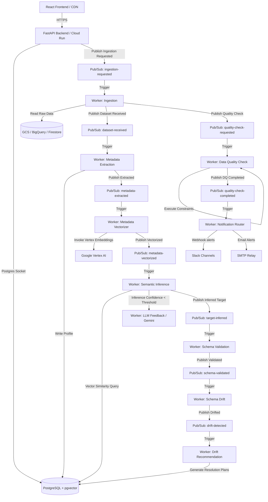

# Smart Data Landing and Schema Intelligence Platform

An enterprise-grade, event-driven data ingestion, schema validation, drift detection, and data quality profiling engine. The platform automates the landing of semi-structured and structured datasets from Google Cloud Storage, BigQuery, and Firestore into target landing zones with semantic target matching, agentic LLM drift resolution, and human-in-the-loop validation.

---

## System Architecture

The platform follows a microservices-inspired architecture coordinated by Google Cloud Pub/Sub and backed by a PostgreSQL database with the `pgvector` extension for semantic target inference.



---

## Directory Structure

```
├── .github/workflows/          # GitHub Actions deployment pipelines
│   └── deploy.yml              # WIF-auth deployment of backend & workers to Cloud Run
├── app/                        # FastAPI Backend Application
│   ├── api/                    # REST endpoint routers (Sources, Jobs, Fallbacks, Recipient config)
│   ├── connectors/             # Cloud data collectors (GCS, BigQuery, Firestore)
│   ├── core/                   # Environment settings & Pydantic config
│   ├── db/                     # SQLAlchemy session lifecycle management
│   ├── models/db/              # Declarative database entities
│   ├── parsers/                # Parse plugins (CSV, JSON, XML, YAML)
│   ├── pubsub/                 # Event publishing utility wrappers
│   └── schemas/                # Pydantic schema schemas
├── frontend/                   # React + TypeScript + Vite SPA
│   ├── src/                    # Source pages (Sources, Configurations, Jobs, DLQ, Audit)
│   └── vite.config.ts          # Vite build config
├── infra/                      # Infrastructure as Code (Terraform)
│   ├── compute.tf              # Artifact Registry & External HTTPS Load Balancer with Cloud CDN
│   ├── iam.tf                  # Workload Identity Federation (WIF) and Service Account permissions
│   ├── pubsub.tf               # Message broker topics and pull subscriptions
│   └── storage.tf              # Frontend & Dataset Landing storage buckets
├── workers/                    # Pipeline Worker Microservices
│   ├── common/                 # Port wrappers & DLQ handlers
│   ├── drift/                  # Schema structural drift analyzer
│   ├── inference/              # pgvector matcher & LLM confidence scoring
│   ├── ingestion/              # Extractor & parser runner
│   ├── metadata/               # Profiler & statistical analyzer
│   ├── notification/           # SMTP & Slack alert router
│   ├── quality/                # Great Expectations style data quality validator
│   ├── recommendation/         # LLM agent resolver generating schema migrations
│   └── vectorizers/            # Vertex AI text embedding sync tasks
├── Dockerfile                  # Multi-service packaging Dockerfile
└── requirements.txt            # System dependencies
```

---

## Event-Driven Pipeline Orchestration

Every dataset ingestion executes in asynchronous phases coordinated via GCP Pub/Sub topics.

1. **Ingestion Request**: A request is received at `/ingestions` on the FastAPI Web API. The API updates the metadata database and publishes a payload containing the `job_id` and `source_id` to the `ingestion-requested` topic.
2. **Dataset Acquisition**: `worker-ingestion` parses the file format (CSV, JSON, XML, YAML) and publishes:
   * A `dataset-received` event.
   * A `quality-check-requested` event (if data quality is enabled in the configuration).
3. **Metadata Profiling**: `worker-metadata` extracts schemas, row counts, null occurrences, and unique ratios, publishing `metadata-extracted`.
4. **Vectorization**: `worker-metadata-vectorizer` requests text embeddings from Vertex AI and stores them. It then publishes `metadata-vectorized`.
5. **Semantic Inference**: `worker-inference` executes cosine similarity queries on the `target_catalog` table using `pgvector`.
   * **High Confidence (>= threshold)**: Matches the source to the landing zone and publishes `target-inferred`.
   * **Low Confidence (< threshold)**: Triggers an LLM feedback loop, holding the pipeline until a reviewer approves or maps the schema.
6. **Schema Validation**: `worker-validation` assesses structural matching (new columns, type changes) and publishes `schema-validated`.
7. **Drift Detection**: `worker-drift` calculates metric drift. If thresholds are exceeded, it publishes `drift-detected`.
8. **Agentic Recommendation**: `worker-recommendation` invokes Gemini to draft SQL schema migration scripts or configuration adjustments.
9. **Enforcement & Alerts**:
   * `worker-quality` runs data validation rules (e.g., uniqueness, bounds, regex match).
   * `worker-notification` routes success/error summaries to Slack channels and SMTP email list subscribers.

---

## Data Quality Configurations

Platform rules are defined via YAML template structures. A sample template configuration is shown below:

```yaml
config_type: SOURCE
config_subtype: GCS
name: "Standard Ingestion & Quality Profile"
description: "Comprehensive parsing, validation, drift detection, and data quality check configuration template."

data_quality_enabled: true
data_quality_sampling:
  sample_ratio: 0.1            # Execute rules on 10% sampling
  random_sample: true

data_quality_rules:
  - type: null_check
    columns: [email, first_name]
    allowed_null_ratio: 0.05
    severity: FAILED

  - type: uniqueness_check
    columns: [id]
    severity: FAILED

  - type: type_validity_check
    columns:
      age: int
      price: float
      is_active: boolean
      created_at: datetime
    severity: WARNING

  - type: boundary_range_check
    columns:
      age:
        min: 0
        max: 120
    severity: WARNING

  - type: regex_pattern_check
    columns:
      email: "^\\S+@\\S+\\.\\S+$"
    severity: FAILED
```

---

## Local Development Setup

### Prerequisites
* Python 3.11+
* Node.js 20+
* PostgreSQL with `pgvector` extension

### 1. Backend Application Setup
1. Create and activate a Python virtual environment:
   ```bash
   python -m venv venv
   .\venv\Scripts\activate  # Windows
   source venv/bin/activate # Unix
   ```
2. Install dependencies:
   ```bash
   pip install -r requirements.txt
   ```
3. Set up the local environment variables in a `.env` file:
   ```env
   DB_HOST=localhost
   DB_PORT=5432
   DB_NAME=metadata_db
   DB_USER=postgres
   DB_PASSWORD=your_password
   GCP_PROJECT_ID=your-project-id
   ```
4. Start the FastAPI local development server:
   ```bash
   uvicorn app.main:app --host 0.0.0.0 --port 8000 --reload
   ```

### 2. Frontend Application Setup
1. Change to the frontend directory:
   ```bash
   cd frontend
   ```
2. Install Node modules:
   ```bash
   npm install
   ```
3. Run the Vite local development server:
   ```bash
   npm run dev
   ```

### 3. Running Background Workers Locally
Since workers coordinate via Pub/Sub, they must be executed separately. To test a worker locally, set the `PYTHONPATH` and execute the module:
```bash
# Windows (PowerShell)
$env:PYTHONPATH="."
python -m workers.ingestion.main

# Unix (Bash)
export PYTHONPATH="."
python -m workers.ingestion.main
```

### 4. Running the Tests
Execute the pytest suite (ensure `PYTHONPATH` points to the root directory):
```bash
$env:PYTHONPATH="."
pytest
```

---

## Production Deployment (Google Cloud Platform)

The platform is designed to be fully containerized and deployed serverless on Google Cloud Platform.

### Compute (Cloud Run)
The backend API and workers are packaged in a single Docker image built from the root `Dockerfile` and deployed as separate **Cloud Run Services**:
* The API runs the default `uvicorn app.main:app` command.
* Workers run the container overriding the execution entry point (e.g. `--command python --args=-m --args=workers.ingestion.main`).
* Services connect securely to **Cloud SQL PostgreSQL** using the Cloud SQL Unix socket.

### Cloud SQL Configuration
To run database queries over Unix sockets rather than TCP, configure the `CLOUD_SQL_CONNECTION_NAME` variable in the deployment environment:
```env
CLOUD_SQL_CONNECTION_NAME=your-gcp-project:region:database-instance-name
```
When present, the application ignores `DB_HOST`/`DB_PORT` and connects via the Unix socket path `/cloudsql/your-gcp-project:region:database-instance-name`.

### Static Frontend Serving
The frontend react assets (`dist/`) are synchronized to a static **Google Cloud Storage** bucket configured for website hosting, and served behind a **Global External HTTP(S) Load Balancer** with **Cloud CDN** enabled for cached, edge delivery.

### GitHub Actions CI/CD (Workload Identity Federation)
Deployments are automated in [.github/workflows/deploy.yml](file:///.github/workflows/deploy.yml). The workflow:
1. Performs automated test checks.
2. Authenticates to GCP using OIDC Workload Identity Federation (WIF).
3. Builds and pushes the Docker image to **Artifact Registry**.
4. Deploys services to **Cloud Run** and syncs compiled assets to the GCS frontend bucket.
